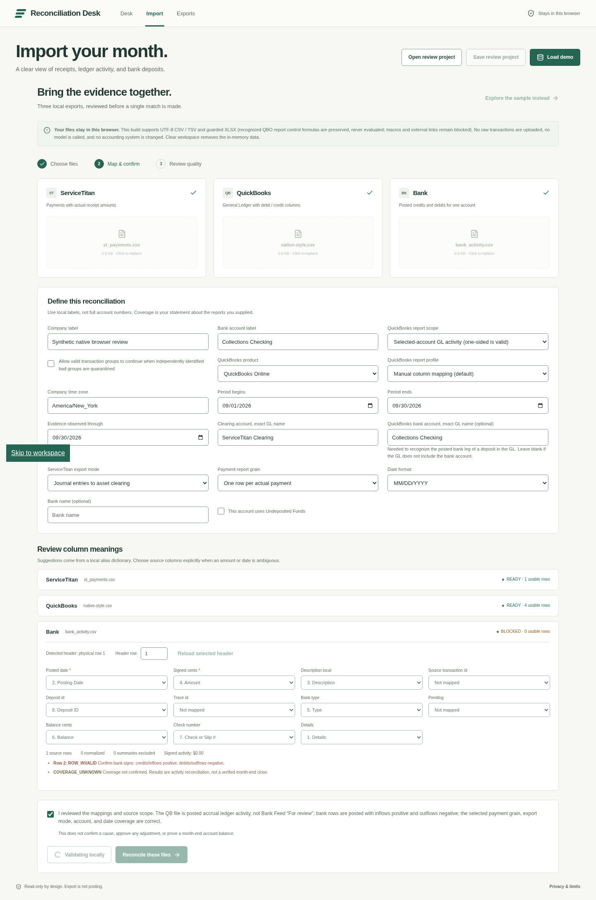
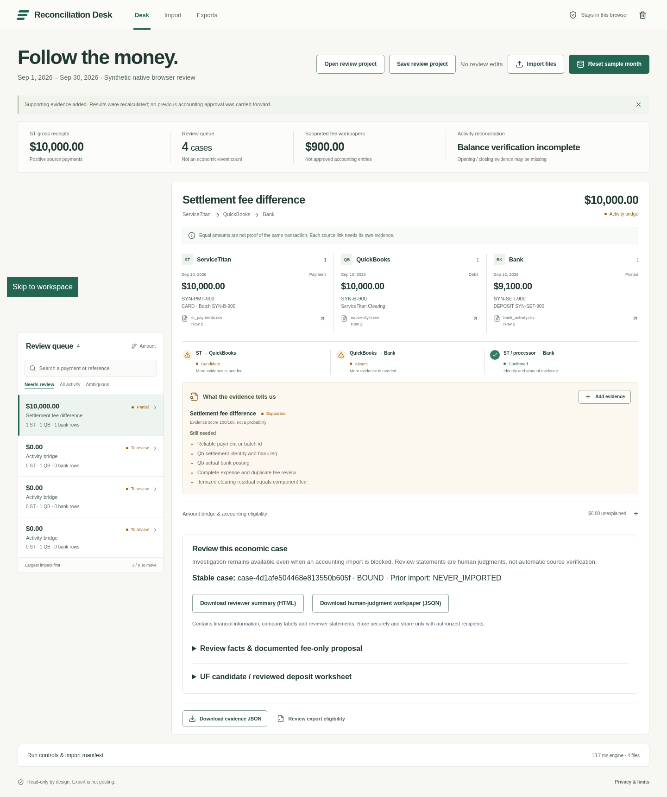
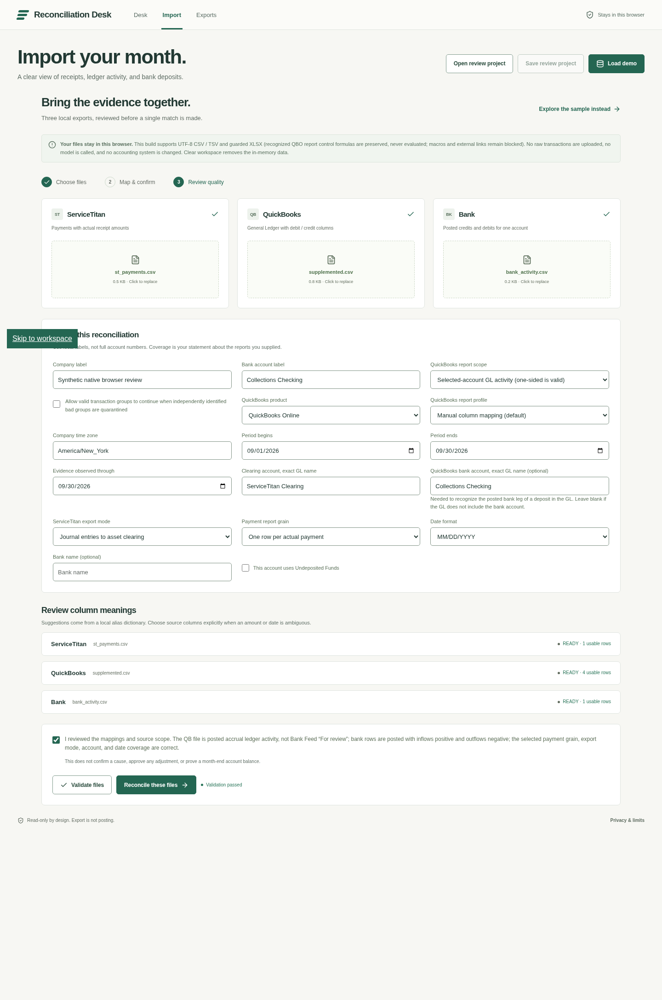
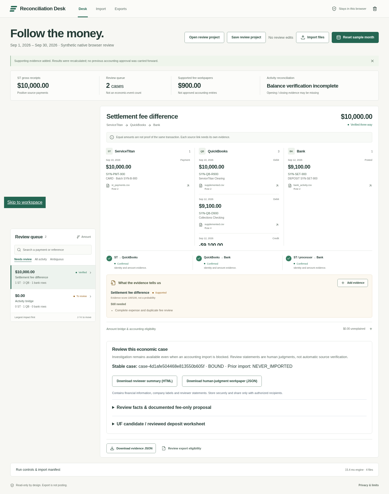

# 原生 GL 缺口与商业验证准备（2026-10-22）

## Verified：本地 H5 测量

本轮没有打开或改写任何 QBO 公司，没有客户数据、外联、支付或上线。`evidence/dot-followup-20261022/native-gl/` 的 CSV 完全合成，不是从 QBO 下载的真实账簿。采用原生报告常见列结构，不冒充跨地区/版本的固定 schema，也不把原生 Transaction Journal 的分组 ID 当作普通 GL 固有字段。

2026-10-22 回读 Intuit 官方 [Run a ledger report that shows debits and credits](https://quickbooks.intuit.com/learn-support/en-us/help-article/profit-loss-reports/create-report-shows-debits-credits-transaction/L1zvqNX0e_US_en_US)：页面指导打开 General Ledger、添加 Debit/Credit/Cleared 并按 Account 筛选，也提醒 classic/enhanced 视图不同。这支持导出准备步骤，不证明所有租户的全部列名或本例业务关系。

执行：`RECORD_NATIVE_GL=1 npx vitest run tests/dot-native-review/native-gl.test.ts`，5/5 PASS。原始输出见 `native-gl/test-output.txt`，原文件 hash、规范行数及每条边实际状态见 `native-gl/measurements.json`。测量记录使用独占写入，重跑普通测试不改证据；要重录需新路径/另存原记录，不覆盖历史。

- `native-style.csv`：11 列、4 行，包含 Date、Transaction Type、Num、Name、Memo/Description、Account、Split、Debit、Credit、Amount、Clr；无 Role、Account Type、Transaction ID、任何 Linked ID。
- 配置明确指定 clearing 与银行科目语义后，实际解析出 CLEARING_RECEIPT、UNKNOWN（A/R）、BANK、CLEARING_SETTLEMENT。Role 和 Account Type 不必作为 CSV 补列。A/R 的 OTHER 映射没有强行把 UNKNOWN 升级为确定的业务角色。
- 原生结构的金额及 Num 虽然与业务样例吻合，仍不能形成 VERIFIED_THREE_WAY。Num 不被偷偷当作交易、付款、结算三种 ID。
- `supplemented.csv`：14 列、4 行。增加 Transaction ID、Linked Payment ID、Linked Deposit ID，共 8 个非空补充单元格；保留原始 11 列。补充值逐行来源与原合成夹具 hash 见 `native-gl/synthetic-linkage-evidence.json`，仅用于实验，不是假装客户凭据。三条边全部 CONFIRMED，gross=1,000,000 cents、bank=910,000 cents、fee=90,000 cents。
- 分别撤掉 Linked Payment ID 或 Linked Deposit ID，均不再 VERIFIED_THREE_WAY。此处没有新增金额匹配代码。

这不是宣称“三列适合所有客户”或最小充分列数的普遍证明。测试仍使用已有合成 ST、银行和结算报表，其本身带明确身份关系。Transaction ID 对于后续逐笔复核及分录事实选择重要；身份缺失时不能用行号伪装原生对象 ID，也不能凭 Num/相同金额编造交易 ID。三方边确认也不是已批准/可导入：科目、完整期间、费用未记账等独立门槛仍须满足。

## Inferred：用户准备负担与错误点

这是可执行引导草案的任务分解，不是计时用户研究，也不是浏览器点击计数。当前测量仅证明列和引擎结果；H5 的真实样本“两小时”阈值尚未测试。

| 阶段 | 用户动作与证据 | 合成样例工作量 | 常见错误 / 正确停止点 |
|---|---|---|---|
| 1 保留原件 | 导出所需期间、accrual、账户范围的 GL，保留原 Excel；另存工作副本 | 1 个 GL 原件 + 1 个工作副本 | 不选 Debit/Credit、遗漏银行腿、把 summary 和 detail 一起加总 |
| 2 映射语义 | 确认期间/时区/公司、posted ledger、行粒度；指定 clearing 和银行账户 | 至少 2 个账户角色映射；其余为导入配置，不算补列 | 同名/错名、UF 当普通 clearing、银行 feed 当已入账 GL |
| 3 检视原生结果 | 先导入原生列，保留缺证据结果 | 1 次原生导入 | 相等金额不证明对象关系；不能把候选说成匹配 |
| 4 获取关系凭据 | 本地查看授权的付款/会计导出明细、Deposit Detail 或交易详情、处理器结算/银行参考 | 本例需要收款→QB 和 QB→deposit 两组关系及两项真实交易身份 | 原生 GL 单独通常不能提供这些对象关系；拿不到就停在调查工作底稿 |
| 5 留存补充表 | 原件哈希 + 物理行号 + 凭据哈希/页号 + 复核人，记录明确对象 ID；生成副本 | 3 列、8 个非空值；另有证据登记，不计为 CSV 值 | 补充字段是人工/额外证据，不是“原生导出字段”；禁止用金额猜测 |
| 6 重新导入 | 选择补充副本并明确替换旧输入，不混加两份 GL | 1 次补充版导入 | 修改副本后 hash 改变；旧审批不得继承；保留原件与副本的链路 |
| 7 复核案例 | 看三条边、金额、来源定位、期间覆盖；必要时走受限草案门槛 | 1 次边链复核；不含完整会计批准 | 无明确证据仍不得导出；原生 GL 能解析不等于 QBO/QBD 验收 |

7 个任务阶段是设计估计；既不是 7 次点击，也不是已完成用户访谈。当前应用尚无自动将旁表凭据安全合并为 GL 的通用向导，本轮只做合成副本和引导草案，不将此人工步骤隐藏成“一键原生支持”。

### 截图引导草案

以下截图来自本轮沙箱真实 Chrome 的可见文件控件导入，不是 UI 设计图。所有数据合成；完整点击日志在 `browser/final/browser-results.json`。

1. 先选原生样式文件并明确账户角色，不加 Role/Linked ID。
   
2. 查看原生结果。仍为 Candidate / Absent，不用金额相等填补缺失关系。
   
3. 在原件之外保留补充凭据与副本，录入明确身份后重新导入。
   
4. 复核实际三条 Confirmed 边。三方证据确认不是会计系统已入账，也不等于可无条件导入。
   

带截图草案已完成；没有真实参与者工时测量，补列动作仍是透明的人工/外部关系证据准备。

## 商业验证材料（已准备、未执行）

`docs/interviews/` 包含五次各有侧重的问题单、统一合成演示脚本、空白记录模板、合成练习记录和判断规则。不是五名真实受访者；没有招募、外联或采访。H1–H5、报价 $199 和节省工时均未验证。

本轮材料不引用 E4/E5/E6/E8/E7b 的事实主张，因此没有把这些线索升级为已核实。E7b 原报告中的 403 仅为历史状态，不声称本轮访问。若未来将任一线索写入访谈背景/宣传，必须逐页回读 URL、记录访问日期、保留无法读取/403 的状态；不能把搜索摘要当原文。E1–E3/E7 的原有 ✔ 仍是原报告的核实记录，不等于本轮重新核验。

## 工程整理：benchmark 与浏览器 harness

`scripts/benchmark-3000.ts` 新支持 `npm run benchmark:3000 -- --output <new-path.json>` 或 `BENCHMARK_OUTPUT`（CLI 优先）。默认写入 `evidence/benchmark-runs/` 的时间戳+随机 UUID 文件，不再写历史目录。mkdir 使用实际目标父目录，写入 `wx`；即使显式指定既有路径也失败而不覆盖。不修改原场景、计时、断言或阈值。路径覆盖测试与实际性能由独立验收记录承担，不凭代码检查宣布通过。

现有 `qa-run.mjs` 使用未在 package.json 声明的 `playwright-core`，硬编码 `/usr/bin/google-chrome`，依赖 QA_IN/QA_OUT；所以目前仅有脚本不等于可复现环境。建议下一步（本轮未新增依赖、未安装浏览器）：

- 独立 QA 工具目录/锁文件或精确版本的 devDependency；锁定 runner 版本与已验收 Chrome 版本，并记录 OS、Chrome 路径、sandbox 状态。生产 bundle 不引入浏览器工具。
- `qa:browser` 包装器在执行前验证 QA_IN、全新 QA_OUT、127.0.0.1 URL、非 root、Chrome 可执行；若 sandbox 失败立即 BLOCKED，禁止 --no-sandbox。
- 输出目录必须不存在或为空，避免混入历史 PASS；循环代理请求、console error 和失败检查必须影响退出码。
- 全程可见控件触发原生 file chooser；等待下载完成后记录 hash；测试应用在 localhost 不代表浏览器后台网络为零，必须区分应用请求与浏览器后台请求。
- 依赖安装、Chrome 系统安装、安全配置与端口变更需按已有环境权限处理。不能为“通过”降低浏览器安全限制。打印、原生 PDF、双标签并发、键盘和辅助技术分别记录，不能由主路径 29 项替代。

### 本轮工程执行证据

`npx vitest run tests/dot-native-review`：2 文件、10/10 PASS（`native-gl/combined-tests.txt`）。其中 5 个为 H5 生产 parser/engine 测试；5 个检查 benchmark 实际路径选择前置代码，独占写入测试为源码守卫，不能冒称运行了碰撞覆盖实验。

实际执行 `npm run benchmark:3000 -- --output evidence/dot-followup-20261022/native-gl/benchmark-configurable.json`：输出在指定新路径，所有安全断言通过；normal p50=650.74ms / p95=945.12ms，mixed p50=752.38ms / p95=1248.61ms，两项 p95<500ms **均 FAIL**。环境共享且存在并发工作，但不能把性能差异原因确认为 CPU 竞争。原始输出和完整 JSON 留存；没有调整阈值或删掉慢测量。命令包装器随后运行 cat，导致 wrapper exit=0，不能把 wrapper 当 benchmark 通过依据；JSON 的 `all_measured_node_targets_passed=false` 是实际结果，脚本据此设 exitCode=1。

历史 `evidence/implementation-20261021/benchmark-3000.json` 未变，SHA-256：`5521e365c73472931857d3fd6d7abbf3ae5bbdae68fb4ce6b9d526d148cb1f4b`。本 lane 未执行默认路径的完整性能复跑，不把前置代码测试称为第二次性能测量。
